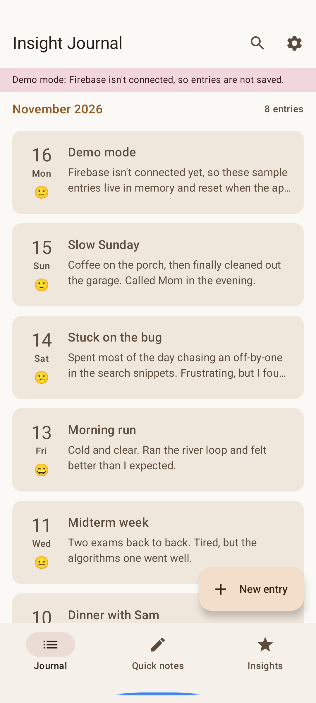
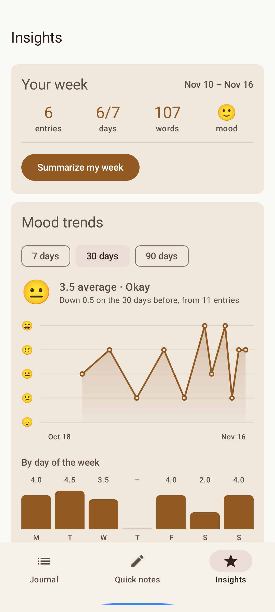
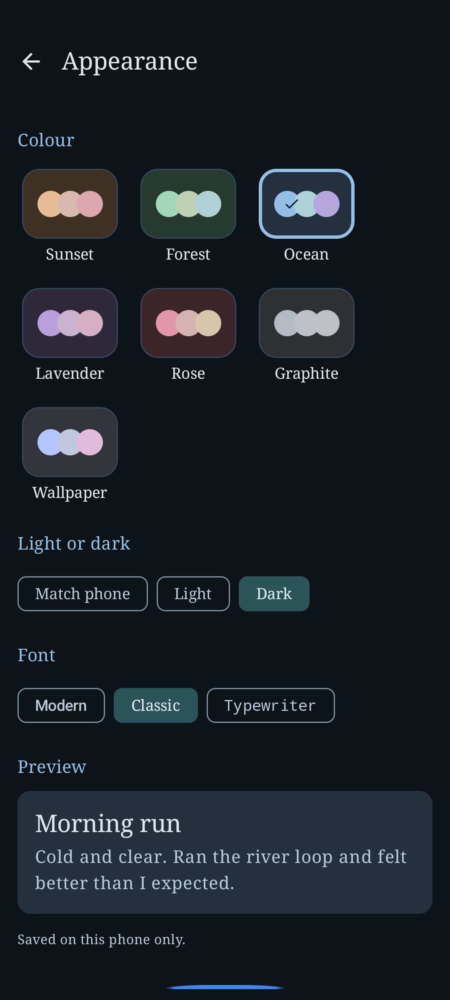
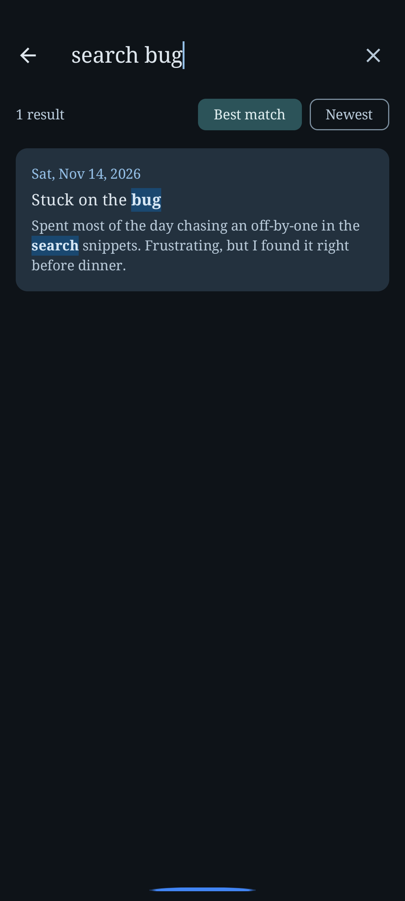
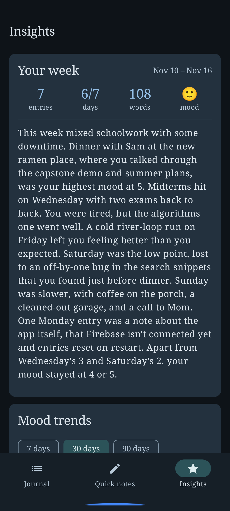
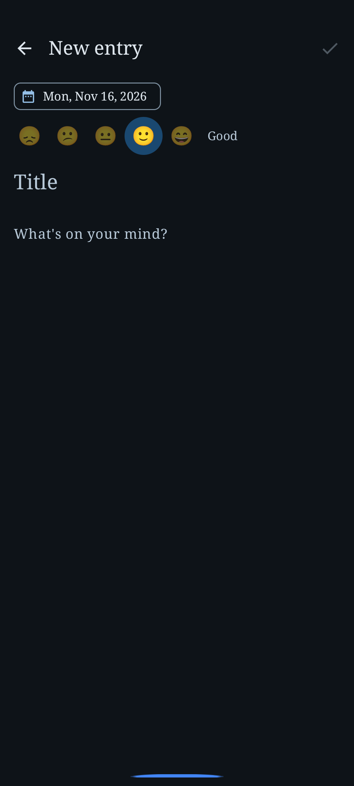
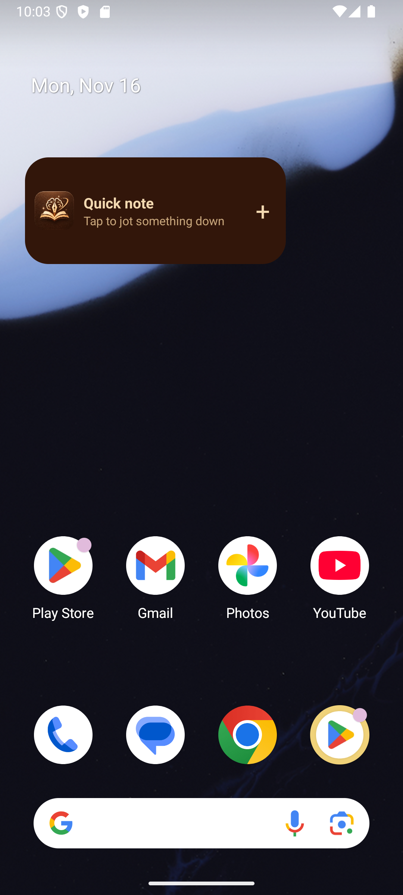

# InsightJournal

**Capture. Reflect. Grow.** An Android journal that helps you look back: jot quick
notes through the day, turn them into entries with AI, track your mood, and find
anything you ever wrote.

<p>
  
  
  
  
</p>

## Features

| | |
|---|---|
| **Journal** | Entries grouped by month, with an optional five-point mood on each. Works offline and syncs when the connection returns. |
| **Quick notes** | Short notes through the day. Long ones get a one-line AI summary; a day's notes can be drafted into a journal entry that you review before saving. |
| **Home screen widget** | Write a quick note from the home screen without opening the app. |
| **Search** | Finds every entry and note containing your words, shows the date first, and highlights the matches. |
| **Mood trends** | A line chart over 7, 30 or 90 days, averages by weekday, how often you felt each way, and your writing streak. |
| **Weekly summary** | An AI recap of the past seven days, generated only when you ask and kept until your writing changes. |
| **Themes** | Seven color themes (including your wallpaper's colors on Android 12+), light or dark, and three fonts. |

<p>
  
  
  
  
</p>

## How it is built

- **Kotlin and Jetpack Compose** (Material 3), single activity, Navigation Compose.
- **MVVM with a repository layer.** ViewModels expose `StateFlow`; repositories are
  interfaces with a Firestore implementation and an in-memory one.
- **Firebase** Auth (email and password) and Firestore, with every user's data
  under `users/{uid}/` so one security rule covers it all.
- **Anthropic API** (Claude Haiku, official Java SDK) for note summaries, entry
  drafts and the weekly summary.
- **Manual dependency injection** through one `AppContainer`; no DI framework.

```
app/src/main/java/com/adam/insightjournal/
  data/        models, repositories (Firestore + in-memory)
  ai/          the Anthropic client and the prompts
  search/      keyword search            (pure Kotlin, unit tested)
  insights/    mood statistics, streaks, week digest  (pure Kotlin, unit tested)
  widget/      home screen widget and its note pop-up
  ui/          one package per screen, plus the theme
```

A few decisions worth pointing out:

- **AI results are generated once and stored.** A note is summarized only if it is
  long enough and has no summary yet. The weekly summary stores a fingerprint of
  the text it was written from, so the app knows when it is out of date without
  calling the API again.
- **Writes never wait for the network.** Firestore applies them to its offline
  cache at once; server rejections come back on a separate error flow.
- **Logic that can be pure is pure.** Search ranking, snippets, mood statistics
  and streaks take plain data and return plain data, which is why they can be
  covered by fast JVM tests with no emulator.
- **Themes are generated, not hand-picked.** Each palette is three hues and a
  saturation; a function derives every Material color role and darkens accents
  until text reaches a 4.6:1 contrast ratio. A test checks every palette.

## Running it

Requirements: Android Studio (or its bundled JDK) and an emulator or phone on
Android 8.0 (API 26) or newer.

```bash
./gradlew assembleDebug
```

**Demo mode.** With no Firebase config, the app runs on sample entries held in
memory, with no sign-in. This is the quickest way to try it.

**With your own Firebase project:**

1. Create a Firebase project, enable Email/Password sign-in and Firestore.
2. Put its `google-services.json` in `app/`.
3. Deploy the rules: `firebase deploy --only firestore:rules,storage`.

**AI features** need an Anthropic API key in `local.properties`:

```
ANTHROPIC_API_KEY=your-key
```

Without it the app works and the AI buttons are switched off. The key is compiled
into the APK, which is fine for a personal build; a published app should call the
API from a server instead.

## Tests

```bash
./gradlew testDebugUnitTest
```

38 unit tests cover search, mood statistics, streaks, the weekly digest and
theme contrast.

## Roadmap

- [x] Core journal with offline sync
- [x] Quick notes with AI summaries and notes-to-entry drafts
- [x] Search, mood trends, weekly summary, themes, home screen widget
- [ ] Semantic search with embeddings (RAG)
- [ ] Voice input and camera/OCR
- [ ] Web companion (React) on the same backend
